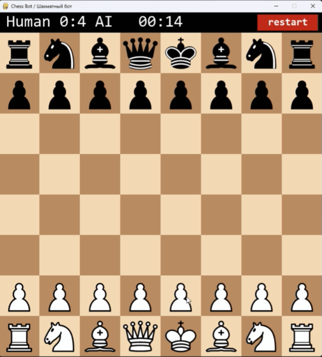

<div align="center">
  <h1>♟️ Hybrid ML Chess Bot / Гибридный шахматный ИИ</h1>
  
</div>

<p align="center">


</p>

## 🚀Использование
Клонируйте репозиторий к себе на компьютер, откройте как проект в IDE, установите зависимости из `requirements.txt` в виртуальное окружение. Используйте версию **Python 3.12**. На более новых версиях могут возникнуть проблемы с совместимостью библиотек.  

### 🕹️Как играть?
1. Запустите `interface.py` и сделайте первый ход. Бот загрузится сам и будет отвечать на ваши ходы.
2. Окончание игры происходит по правилам шахмат ФИДЕ, возможен мат или пат. Если мат поставите вы - бот проанализирует ваши ходы и в следующий раз будет играть лучше.
3. Начать партию заново можно кнопкой *restart*.
4. Вы можете закрыть приложение в любое время, но тогда текущая партия не сохранится.
5. Счёт побед/поражений нужен лишь для вашего удобства и ни на что не влияет.
6. Запуск файла `engine.py` запустит процесс переобучения бота с нуля на основе `game_dataset.csv`. Ваш прогресс "личного обучения" будет сброшен.
- Вы также можете заменить файл `game_dataset.csv` на другой и обучить бота на нём при соблюдении нескольких условий:
  - Формат файла `.csv`
  - Разделители `;`
  - Есть столбец `moves`, в котором представлена одна шахматная партия, записанная в алгебраической нотации
  
**НЕ СЛЕДУЕТ** самостоятельно запускать файл `engine.py`, если вы не планируете менять датасет или заново обучать бота.

## 🧩Структура
### 📁Назначение файлов
```text
Hybrid_ML_chess_bot/
├── IMG/                  # PNG фигур, подгружаются при каждом запуске
├── .gitignore            # Тех. файл Git
├── README.md             # Тех. файл Git
├── engine.py             # Нейросеть и её методы. Самостоятельный запуск = перезапись весов модели.
├── example.gif           # Пример игры со страницы GitHUB
├── games_dataset.csv     # Датасет для обучения
├── interface.py          # Основной файл, интерфейс сам подключает нейросеть и нужные файлы
├── requirements.txt      # Список необходимых библиотек
├── score.txt             # Счёт игрок против машины
└── weights.pt            # Веса модели
```
### 🕸️Архитектура нейросети
```text
┌────────────┐   ┌────────────┐   ┌────────────┐   ┌────────────┐
│    Вход    │   │  Conv 3×3  │   │  Conv 3×3  │   │  Conv 3×3  │
│  12 слоёв  │──▶│   12→64    │──▶│   64→64   │──▶│   64→64    │
│   12×8×8   │   │    ReLU    │   │    ReLU    │   │    ReLU    │
└────────────┘   └────────────┘   └────────────┘   └────────────┘
                                                          │
       ┌──────────────────────────────────────────────────┘
       │
       ▼
┌────────────┐   ┌────────────┐   ┌────────────┐   ┌────────────┐
│  Flatten   │   │   Linear   │   │   Linear   │   │   Выход    │
│   64×8×8   │──▶│  4096→512  │──▶│  512→4096 │──▶│   логиты   │
│   → 4096   │   │    ReLU    │   │            │   │ 4096 ходов │
└────────────┘   └────────────┘   └────────────┘   └────────────┘
```
### 🔍Представление данных

| Что | Как кодируется |
|---|---|
| Позиция | Тензор `12x8x8`: 6 типов своих фигур + 6 типов чужих, доска 8x8 |
| Чёрные | Доска зеркалится по вертикали, "свои" и "чужие" меняются местами |
| Ход | Число `from * 64 + to` (0…4095), превращение пешки только в ферзя |
| Легальность | Маска легальных ходов из `python-chess`: в обучении нелегальным ходам ставится −∞ |

### ⚖️Выбор хода
```text
Для каждого легального хода:
Оценка хода = ln(вероятность хода по мнению сети) + (значимость материала) * (изменение материала после лучшего ответа соперника)
```

---

<details>
<summary><h3>ENG | Description</h3></summary>

## 🚀Usage
Clone the repository to your computer, open it as a project in your IDE, and install the dependencies from `requirements.txt` into a virtual environment. Use **Python 3.12**. Newer versions may cause library compatibility issues.

### 🕹️How to play?
1. Just run `interface.py` and make your first move. The bot will load automatically and respond to your moves.
2. The game ends according to FIDE chess rules; checkmate or stalemate is possible. If you deliver checkmate, the bot will analyze your moves and play better next time.
3. You can start a new game with the *restart* button.
4. You can close the application at any time, but the current game will not be saved.
5. The win/loss score is only for your convenience and does not affect anything.
6. Running `engine.py` will start the process of retraining the bot from scratch based on `game_dataset.csv`. Your "personal training" progress will be reset.
- You can also replace `game_dataset.csv` with another file and train the bot on it, provided the following conditions are met:
  - File format `.csv`
  - Delimiter `;`
  - A `moves` column containing one chess game written in algebraic notation

**DO NOT** run `engine.py` on your own unless you plan to change the dataset or retrain the bot.

## 🧩Structure
### 📁Purpose of files
```text
Hybrid_ML_chess_bot/
├── IMG/                  # PNG piece images, loaded on every launch
├── .gitignore            # Git technical file
├── README.md             # Git technical file
├── engine.py             # Neural network and its methods. Running it standalone = overwriting the model weights.
├── example.gif           # Example game from the GitHub page
├── games_dataset.csv     # Training dataset
├── interface.py          # Main file; the interface connects the neural network and required files itself
├── requirements.txt      # List of required libraries
├── score.txt             # Player vs. machine score
└── weights.pt            # Model weights
```
### 🕸️Neural network architecture
```text
┌────────────┐   ┌────────────┐   ┌────────────┐   ┌────────────┐
│    Input   │   │  Conv 3×3  │   │  Conv 3×3  │   │  Conv 3×3  │
│  12 planes │──▶│   12→64    │──▶│   64→64    │──▶│   64→64    │
│   12×8×8   │   │    ReLU    │   │    ReLU    │   │    ReLU    │
└────────────┘   └────────────┘   └────────────┘   └────────────┘
                                                          │
       ┌──────────────────────────────────────────────────┘
       │
       ▼
┌────────────┐   ┌────────────┐   ┌────────────┐   ┌────────────┐
│  Flatten   │   │   Linear   │   │   Linear   │   │   Output   │
│   64×8×8   │──▶│  4096→512  │──▶│  512→4096  │──▶│   logits   │
│   → 4096   │   │    ReLU    │   │            │   │ 4096 moves │
└────────────┘   └────────────┘   └────────────┘   └────────────┘
```
### 🔍Data representation

| What | How it is encoded |
|---|---|
| Position | `12x8x8` tensor: 6 of your piece types + 6 of the opponent's, 8x8 board |
| Black | The board is mirrored vertically, "own" and "opponent" pieces are swapped |
| Move | Number `from * 64 + to` (0…4095), pawn promotion to queen only |
| Legality | Legal move mask from `python-chess`: during training, illegal moves are set to −∞ |

### ⚖️Move selection
```text
For each legal move:
Move score = ln(probability of the move according to the network) + (material significance) * (change in material after the opponent's best reply)
```

</details>

